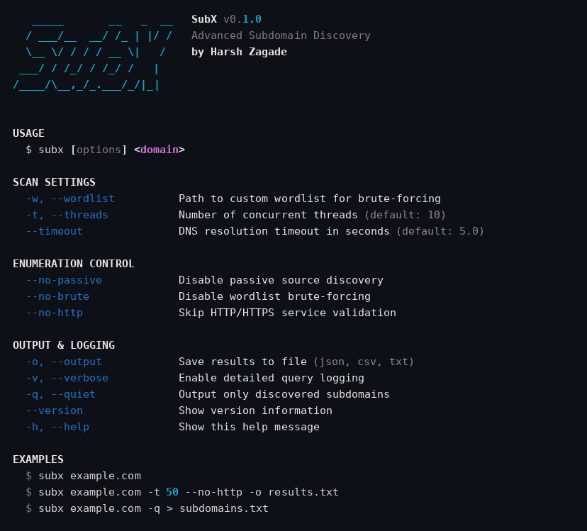

# SubX

<p align="center">
  
  
  
</p>

> **In simple words:** websites are like buildings with many rooms. SubX finds all the hidden rooms — the subdomains of a site that most people never see.

**SubX** is a subdomain discovery tool for security professionals and bug bounty hunters. It finds subdomains of a target domain two ways: by querying passive OSINT sources (certificate transparency logs, DNS record aggregators, threat intel), and by actively brute-forcing DNS with a wordlist. Every candidate is then validated — DNS resolution, automatic wildcard filtering, and an HTTP/HTTPS service check — and the results are shown in a rich terminal table or exported to JSON, CSV, or plain text.

---

## ✨ Key Features

- **🔍 Hybrid Discovery**
  - **Passive enumeration:** queries crt.sh, HackerTarget, and AlienVault OTX APIs in parallel
  - **Active brute-forcing:** DNS resolution against a bundled wordlist of 84 common subdomains (or your own)
  - **Wildcard detection:** automatically detects wildcard DNS and filters out false positives
- **⚡ Performance**
  - Multi-threaded validation with configurable thread count (default 10)
  - Short-timeout HTTP/HTTPS checks (HTTPS first, then HTTP)
  - Skip HTTP validation entirely (`--no-http`) for faster pure-DNS scans
- **📊 Flexible Output**
  - Rich terminal table with progress bars and colored status codes
  - Export to JSON, CSV, or plain text for pipelines and further analysis
  - Quiet mode (`-q`) prints only subdomains — perfect for piping into httpx, nuclei, etc.
- **🛡️ Accuracy**
  - Two random-subdomain probes detect wildcard DNS before the scan starts
  - Status per subdomain: HTTP status code, `No HTTP` (resolves, no web service), or `N/A` (HTTP checks skipped)
  - IP address resolution and grouping per subdomain
  - `--only-live` shows only subdomains with a working HTTP service, hiding DNS-only rows — ideal for recon pipelines

---

## 📦 Installation

Requires Python 3.6+ and internet access (passive sources are web APIs, and scans need DNS).

### Using pipx (recommended)
```bash
git clone https://github.com/harshzagade/SubX.git
cd SubX
pipx install .
```

### Using pip
```bash
git clone https://github.com/harshzagade/SubX.git
cd SubX
pip install .
```

### From source (development)
```bash
git clone https://github.com/harshzagade/SubX.git
cd SubX
python -m venv venv
source venv/bin/activate   # Windows: venv\Scripts\activate
pip install -e .
```

Dependencies: `requests`, `dnspython`, `rich`, `click` (see `requirements.txt`).

---

## 🚀 Quick Start

```bash
# Full scan: passive sources + wordlist brute-force + HTTP validation
subx example.com

# Faster scan: skip the HTTP service checks
subx example.com -t 50 --no-http

# Passive enumeration only (quietest — no DNS brute-forcing)
subx example.com --no-brute

# Save results to a file
subx example.com -o results.json

# Quiet mode: only subdomains, ready to pipe into other tools
subx example.com -q | httpx -silent
```

---

## 📖 Usage Examples

### Custom wordlist
```bash
subx example.com -w /path/to/wordlist.txt
```

### Active brute-force only
```bash
subx example.com --no-passive -w custom.txt
```

### Passive enumeration only
```bash
subx example.com --no-brute
```

### Skip HTTP validation (faster, DNS-only results)
```bash
subx example.com --no-http -t 100
```

### Custom DNS timeout
```bash
subx example.com --timeout 10
```

### Retry flaky DNS queries
```bash
subx example.com --dns-retries 2   # retry each timed-out DNS query twice (default: 1)
```

### Internationalized domain names
```bash
subx münchen.de   # converted to xn--mnchen-3ya.de (punycode) automatically
```
Unicode targets are normalized with the stdlib IDNA codec before any
DNS query, so internationalized domains scan without erroring out.

### Multiple output formats
```bash
subx example.com -o results.json   # JSON
subx example.com -o results.csv    # CSV
subx example.com -o results.txt    # plain text
```

### Verbose logging
```bash
subx example.com -v
```

---

## 🖼️ Screenshots

Real terminal capture from SubX v0.1.0 (`subx --help` — the only command that runs without scanning anything):



A real scan prints a rich results table with columns **Subdomain**, **Status**, **Source** (Passive / Brute / Both), and **IP Addresses**, followed by a summary line (`Finished in Xs. Found N active subdomains.`).

---

## 🎯 How It Works

### 1. Wildcard Detection
Before anything else, SubX probes two random 15-character subdomains of the target. A wildcard is declared only when at least two probes resolve AND agree on at least one IP — a single resolving probe is treated as an anycast fluke and ignored, so one stray answer can no longer poison the filter for the whole scan. The agreed wildcard IPs are recorded, and any later result resolving only to wildcard IPs is dropped as a false positive. If no wildcard is found, a note is printed and scanning continues normally.

### 2. Passive Enumeration
Three OSINT sources are queried in parallel (each with a 15-second timeout; a failed source is skipped, not fatal):
- **crt.sh** — Certificate Transparency logs; subdomain names are validated against a strict domain regex and wildcard entries (`*.example.com`) are excluded
- **HackerTarget** — DNS record aggregation API
- **AlienVault OTX** — passive DNS records

All unique subdomains found are combined.

### 3. Active Brute-Forcing
Each word from the wordlist is prefixed to the domain (`api.example.com`), resolved via DNS, and checked against the wildcard IP set. Subdomains found this way that were also found passively are tagged as source **Both**; otherwise **Passive** or **Brute**.

On noisy targets, `--exclude-sub PATTERN` (repeatable) skips brute-force candidates matching the glob — e.g. `--exclude-sub '*.blog.*'` drops everything under any `blog` subdomain before any DNS query is made. Patterns are matched against the full candidate name, case-insensitively; an invalid (empty) pattern fails fast with exit code 2. The flag applies to brute-force only, not passive candidates.

Case-variant duplicates in the wordlist (e.g. `Admin` and `admin`, common in wordlists merged from several sources) are collapsed to a single candidate before any DNS query is made — DNS is case-insensitive, so probing both would waste queries. The dropped count is logged.

### 4. Validation
Each candidate is resolved to its A records and then probed: HTTPS first, then HTTP, with a 3-second timeout (configurable via `--http-timeout`). A 2xx/3xx response records the status code; a subdomain that resolves but has no web service shows `No HTTP`; with `--no-http` the status shows `N/A` and DNS-only results are returned.

**CNAME aliases are followed, not dropped.** If a candidate is only a CNAME record (e.g. pointing at a CDN or a cloud load balancer), SubX follows the chain — up to 5 hops, loops cut at the first repeated name — and resolves the final target's A records, so the alias is no longer reported as a miss. The first CNAME target is reported in the results table's `CNAME` column (and in JSON/CSV/text output), while the HTTP probe still targets the original subdomain so the Host header and TLS SNI stay correct.

**DNS results are cached per FQDN across phases.** Brute-forcing validates every wordlist candidate, and the validation phase then re-validates all hits — without a cache, every brute-force hit would be resolved twice (CNAME chain + A records). The `Validator` keeps a per-name cache of the resolved IPs and CNAME alias, so the validation phase reuses the brute-force phase's DNS work instead of repeating it; dead names are cached too, and DNS timeouts are never cached (they are retried fresh, since they are transient). The scan summary reports how many lookups were served from the cache.

### Wildcard-domain behavior in detail

- **Detection:** before scanning, SubX probes two random 15-character
  subdomains (A records only) of the target. The target is treated as
  wildcard DNS only when **both** probes resolve **and** their answers
  agree on at least one IP; a lone resolving probe (an anycast fluke)
  is ignored. A yellow `Wildcard detected` warning shows the agreed
  IPs; if the probes do not agree, a blue `No wildcard detected` note
  is printed and scanning continues normally.
- **Filtering rule:** a candidate is dropped as a false positive only
  when **every** IP it resolves to is in the wildcard set. A subdomain
  that resolves to a mix of wildcard and unique IPs is **kept** — real
  services frequently sit behind the same CDN or load balancer as the
  wildcard, so partial matches are not filtered.
- **On a full-wildcard target** (every name resolves to the same IPs),
  brute-forcing adds little signal: passive enumeration still finds real
  named hosts from certificate logs, and `--no-brute` keeps the scan
  quiet and fast. The yellow wildcard warning is your cue that results
  passed through the filter.
- **Caveats:** the probes are A-record lookups, so CNAME-based
  wildcards are not detected. Wildcards whose answers rotate per
  query (round-robin sinks returning disjoint IP sets per probe) will
  not be declared, since the probes must share at least one IP.
  Subdomains dropped by the filter never reach the results table or
  output files.
- **Summary:** when the filter drops candidates, the end-of-scan summary
  reports the count (e.g. `Filtered 37 wildcard false positive(s).`), so
  a filtered scan does not look identical to a clean one.

---

## 🔧 CLI Options

```
usage: subx [options] <domain>

positional arguments:
  domain                Target domain (e.g., example.com)

scan settings:
  -w, --wordlist PATH   Path to custom wordlist for brute-forcing
  -t, --threads NUM     Number of concurrent threads (default: 10)
  --timeout SEC         DNS resolution timeout in seconds (default: 5.0)
  --http-timeout SEC    Timeout in seconds for each HTTP/HTTPS probe request (default: 3.0)
  --dns-retries NUM     Retry attempts per DNS query after a timeout (default: 1)

enumeration control:
  --no-passive         Disable passive source discovery
  --no-brute           Disable wordlist brute-forcing
  --exclude-sub GLOB   Skip brute-force candidates matching the glob (repeatable)
  --no-http            Skip HTTP/HTTPS service validation
  --only-live          Show only subdomains with a working HTTP service (hides DNS-only rows)

output & logging:
  -o, --output FILE    Save results to file (.json, .csv, .txt)
  -v, --verbose        Enable detailed query logging
  -q, --quiet          Output only discovered subdomains
  --version            Show version information
  -h, --help           Show this help message
```

---

## 🎨 Output Formats

Before display or saving, results are deduplicated (spelling variants of
the same DNS host, e.g. letter case or a trailing dot, are collapsed into
one row) and sorted by subdomain, so the table, quiet output, and saved
files all show the same clean list.

### JSON
```json
[
  {
    "subdomain": "api.example.com",
    "status": "200",
    "source": "Brute",
    "ips": "104.20.23.154, 172.66.147.243"
  }
]
```

### CSV
```csv
Subdomain,Status,Source,IP Addresses
api.example.com,200,Brute,"104.20.23.154, 172.66.147.243"
www.example.com,301,Both,"172.66.147.243"
```

### Plain Text
```
api.example.com (200) - 104.20.23.154, 172.66.147.243
www.example.com (301) - 172.66.147.243
```

---

## 🔄 Integration Examples

### Chain with HTTPx
```bash
subx example.com -q | httpx -silent -status-code
```

### Chain with Nuclei
```bash
subx example.com -q | nuclei -t vulnerabilities/
```

### Export for further analysis
```bash
subx example.com -o subs.json
jq -r '.[].subdomain' subs.json | httprobe
```

---

## 🏗️ Architecture

```
subx/
├── cli.py           # Command-line interface and argument parsing
├── enumerator.py    # Passive OSINT and DNS brute-forcing logic
├── filters.py       # --exclude-sub glob matching (stdlib-only)
├── wordlist.py      # wordlist loading + case-variant dedup (stdlib-only)
├── validator.py     # DNS resolution, wildcard detection, HTTP/HTTPS validation
├── utils.py         # Terminal UI, logging, and formatting
└── data/
    └── default_wordlist.txt  # Built-in subdomain wordlist (84 entries)
```

Tests live in `tests/` (run with `pytest`). See [TESTING_NOTES.md](./TESTING_NOTES.md) for verification details.

**Note:** SubX needs internet connectivity and a real domain to scan — localhost testing is not supported, and there is no built-in demo mode.

---

## 🛡️ Default Wordlist

SubX ships with a curated wordlist of 84 common subdomains, including:
- `www`, `mail`, `api`, `dev`, `staging`
- `admin`, `portal`, `vpn`, `blog`, `shop`

Located at: `subx/data/default_wordlist.txt`. Override it with `-w /path/to/wordlist.txt`.

---

## ⚡ Performance Tips

### Maximum speed (DNS only)
```bash
subx example.com -t 100 --no-http --no-passive
```

### Balanced scan
```bash
subx example.com -t 50
```

### Quiet passive-only enumeration
```bash
subx example.com --no-brute -q
```

---

## 🤝 Contributing

Contributions are welcome! Please feel free to submit a Pull Request.

---

## 📄 License

This project is licensed under the MIT License — see the [LICENSE](LICENSE) file for details.

---

## 👨‍💻 Author

**Harsh Zagade**
- GitHub: [@harshzagade](https://github.com/harshzagade)
- LinkedIn: [harsh-zagade](https://linkedin.com/in/harsh-zagade)

---

## 🙏 Acknowledgments

- Certificate Transparency Project
- HackerTarget API
- AlienVault OTX Community
- Bug bounty hunters worldwide

---

## ⚖️ Disclaimer

This tool is intended for authorized security research and bug bounty programs only. Always obtain proper authorization before scanning domains you do not own.

---

**Built with ❤️ for the bug bounty community**
